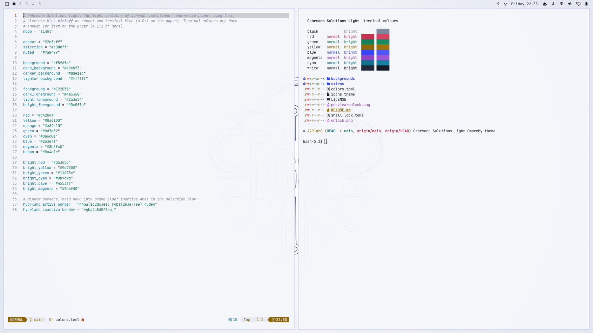

# Gehrmann Solutions Light — Omarchy theme

The light variant of the [Gehrmann Solutions](https://github.com/GehrmannSolutions/omarchy-gehrmann-solutions-theme)
[Omarchy](https://omarchy.org) theme: the light sections of
[gehrmann.solutions](https://gehrmann.solutions) — near-white paper, navy text, electric-blue
accent — with the dark theme's logo inverted (navy outline, white fill).



```bash
omarchy theme install https://github.com/GehrmannSolutions/omarchy-gehrmann-solutions-light-theme.git
```

## Palette

| Role | Colour | |
|---|---|---|
| Background | `#f5f6fa` | paper |
| Foreground | `#192031` | navy |
| Accent, terminal blue | `#2e3eff` | the brand blue (6.0:1 on the paper) |
| Selection | `#c8d0ff` | |

Window borders run from bold navy into the brand blue. The terminal colours are dark enough to
read as text on the paper (4.1:1 or more; the normal ones 5:1 or more).

## What is in it

| File | Used for |
|---|---|
| `colors.toml` | the palette; Omarchy generates the terminal, editor, btop, browser and shell colours from it |
| `backgrounds/` | 1 inverted logo (default), 2 logo in brand blue, 3 inverted logo with a soft glow, 4 the site's dot sunburst, 5 plain paper |
| `unlock.png` | the logo in brand blue on the boot and disk-unlock screen (Plymouth): *Style › Unlock* in the Omarchy menu, or `omarchy plymouth set-by-theme gehrmann-solutions-light` |
| `shell.lock.toml` | lock screen password field: bold-navy frame, brand blue while typing |
| `icons.theme` | `Yaru-blue` (package `yaru-icon-theme`) |
| `preview.png`, `preview-unlock.png` | the theme picker's previews |

## Extras (optional)

The logo on the lock screen and the screensaver artwork work as described in the
[dark theme's README](https://github.com/GehrmannSolutions/omarchy-gehrmann-solutions-theme#extras-optional);
both are in `extras/` here too:

```bash
~/.config/omarchy/themes/gehrmann-solutions-light/extras/gs-lock-logo install
```

## Building

The images are generated from the logo SVG by `tools/build.sh` in
[GehrmannSolutions/Omarchy](https://github.com/GehrmannSolutions/Omarchy/tree/main/Themes/gehrmann-solutions),
which builds this theme and the dark one together. Edit there, not here.

## Licence

See [LICENSE](LICENSE).
